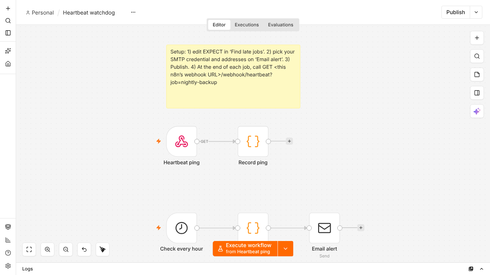

# n8n Heartbeat Watchdog (free)

Catches the failure n8n can't: a scheduled job that **silently didn't run**, or ran and did nothing. An error workflow only fires when a run *fails*. This one flips it around: each job pings a URL when it finishes, and an hourly check emails you if a job has been quiet for longer than you allow.

## How it works
- **Ping:** at the end of each job, call `GET <your n8n>/webhook/heartbeat?job=nightly-backup`. The workflow stores the time of the last ping per job.
- **Check:** every hour a Code node compares each job's last ping with the limit you set in `EXPECT` (hours). A late job produces one email naming the job and how long it has been quiet.
- **One alert per outage:** you are not emailed every hour. The next ping re-arms the alert.
- **No false alarm on install:** a job that has never pinged is measured from the first check, not from the beginning of time.

## Use
1. In n8n: Workflows > Import from file > `heartbeat-watchdog.json`.
2. Open **Find late jobs** and edit `EXPECT` (job name and the longest silence you accept, in hours).
3. Open **Email alert**: select your SMTP credential and set from/to (placeholders: `you@example.com`).
4. **Publish** the workflow. It ships inactive.
5. Add a final step to each job that calls the ping URL (an HTTP Request node, or `curl -fsS "https://YOUR-N8N/webhook/heartbeat?job=nightly-backup"` at the end of a shell script). Use only letters, digits, `_` and `-` in job names.

To watch a job that *runs* but may do nothing, put the ping node **after** the step that proves work happened (for example after an IF on "rows > 0"), so an empty run does not ping.

## What was tested (local n8n 2.35.7, local test mail server)
- A job that pinged every 20 s was never reported; a job that never pinged produced exactly one email.
- After a pinged job stopped pinging it produced one email, not one per check.
- After a ping, a job that went quiet again was reported again (re-armed).
- After restarting n8n, the stored ping times and the "already alerted" flags were still there (the job was reported with its real last-ping time, and an already-alerted job was not repeated). Tested once, on a local SQLite install.
- Test used a 1-minute schedule and a 36-second limit. The shipped file uses an hourly check and hour limits; only those values differ. See `testing/`.

## Not tested
- n8n upgrades, and databases other than the default SQLite.
- Cloud n8n, queue mode with several workers, and the Gmail node (the alert uses the SMTP Send Email node).
- Pings sent with POST (the webhook accepts GET only), and very busy instances.
- The check cannot run while n8n itself is down; for that you need a monitor outside n8n.

## Notes
- The ping URL has no password. Anyone who knows it can send a fake "I'm alive" ping. Keep it private, or put the n8n webhook behind your own access control.
- Alert timing is the hourly check plus your limit, so allow slack in `EXPECT`.

## Want more?
This repo is a companion to the free [n8n Error Alert](https://github.com/NotOptional1/n8n-error-alert-lite) (alerts when a run fails). The **n8n Small-Business Ops Pack** has 5 more workflows (invoice reminders, lead intake, weekly digest, consent-based review requests): https://gilishe.gumroad.com/l/n8n-ops-pack

## Notices
MIT licensed (see LICENSE). n8n is a trademark of n8n GmbH; this workflow is not affiliated with or endorsed by n8n. It runs on n8n under n8n's own licence, which you accept when you use n8n. Created with AI assistance (Claude) and tested as described here.
